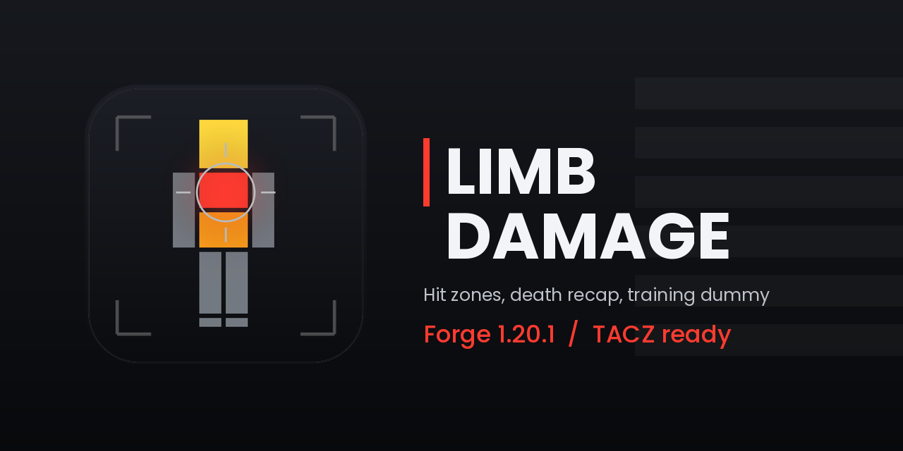

  
  
  
  

# Limb Damage

Hit the leg and it hurts less than the chest, the way it works in Call of Duty.

Every body part has its own damage number, and TACZ guns can have theirs per gun type. When you die you get a
recap of who hit you, with what, and where. There's also a training dummy you can dress up and shoot.

TACZ and Accurate Hitboxes are optional. With them, hit locations are exact; without them the mod follows the
bullet's path through the player model.

## Features

- Six hit zones (head, chest, abdomen, arms, legs, feet) with their own multipliers, for players and humanoid mobs
- Per gun type numbers for TACZ (pistol, rifle, sniper, RPG, SMG, shotgun, MG)
- Death recap and "damage done" strip, with KILL / DEAD badges
- Training dummy with an equipment screen and per-dummy stats
- Fragile effect: full limb damage and delayed regeneration
- YACL config screen, 0.1% damage sliders, live reload on servers
- Sharp HUD drawn in real screen pixels, custom HUD font support

## Install

Minecraft 1.20.1, Forge 47.4.10+, Java 17, and [YACL](https://modrinth.com/mod/yacl) 3.6.x. Put the jar and YACL in
`mods/` on the server and on clients. Details, upgrading from 1.x and server setup are in the
[wiki](docs/wiki/Installation.md).

## Docs

Everything lives in [`docs/wiki`](docs/wiki/Home.md) (it's written to be pushed straight to the GitHub wiki):
[damage zones](docs/wiki/Damage-Zones.md), [configuration](docs/wiki/Configuration.md),
[weapon categories](docs/wiki/Weapon-Categories.md), [training dummy](docs/wiki/Training-Dummy.md),
[commands](docs/wiki/Commands.md), [FAQ](docs/wiki/FAQ.md).

## Building

`./gradlew build`. Needs JDK 17 and the Accurate Hitboxes jar in `libs/`; see [`libs/README.md`](libs/README.md)
and the [build notes](docs/wiki/Building.md).

## Contributing

Bug reports and pull requests are welcome, see [CONTRIBUTING.md](CONTRIBUTING.md). Changes per version are in
[CHANGELOG.md](CHANGELOG.md).

## License

GPL-3.0-only, see [LICENSE](LICENSE).
